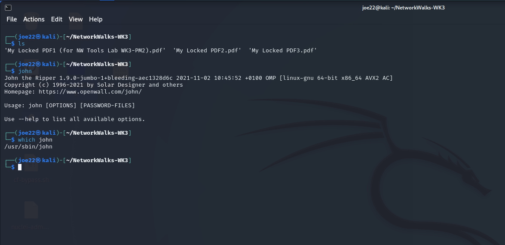
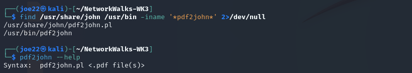
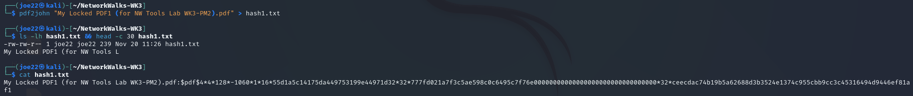
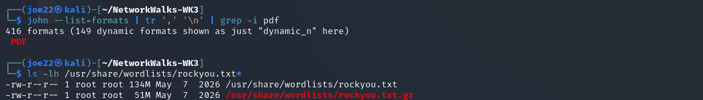
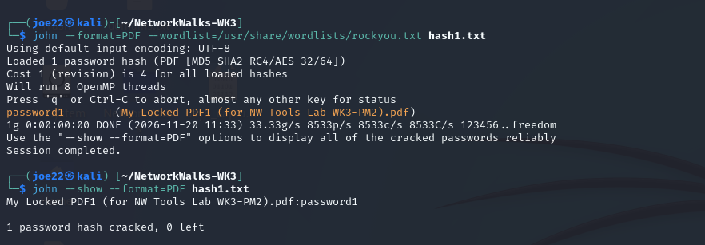
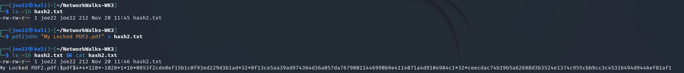
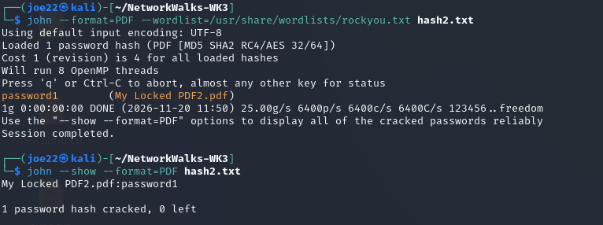
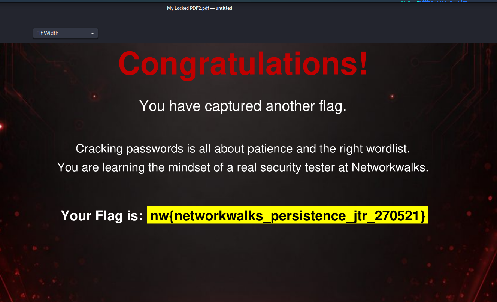
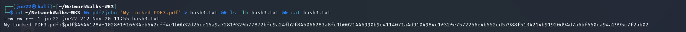
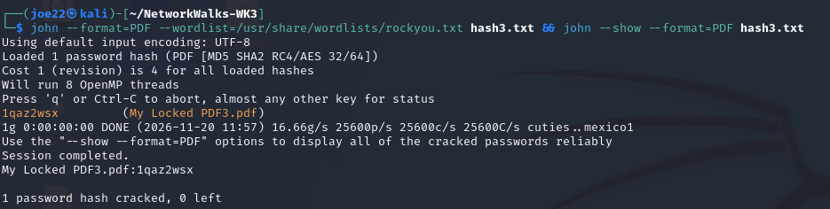

# NetworkWalks B084 – Week 3 | John the Ripper: PDF Password Recovery

<p align="center">
  
  
  
  
  
</p>

## 📌 Project Overview

This repository documents my **Week 3 practical for the NetworkWalks B084 Cybersecurity Training Program**.

The practical focuses on PDF password recovery using **John the Ripper**, a widely used password auditing and recovery tool.

I performed the exercises in Kali Linux, using `pdf2john` to extract password hash information from protected PDF files and the RockYou wordlist to perform dictionary-based password recovery.

The practical also involved verifying recovered passwords and opening the protected PDF documents.

The objective was to understand how password-protected files can be audited and how dictionary-based password recovery works in a controlled cybersecurity lab environment.

---

## 🎯 Learning Objectives

- Understand the purpose and functionality of John the Ripper.
- Identify and verify the required password auditing utilities.
- Understand PDF password hash extraction.
- Use `pdf2john` to extract PDF password hashes.
- Understand dictionary-based password attacks.
- Use the RockYou wordlist for password auditing.
- Perform password recovery using John the Ripper.
- Verify recovered passwords using `john --show`.
- Open and verify password-protected PDF documents.
- Document the complete practical with screenshots and command-line evidence.

---

## 🖥️ Lab Environment

| Component | Details |
|---|---|
| Training Program | NetworkWalks B084 |
| Practical | Week 3 |
| Operating System | Kali Linux |
| Virtualization | Oracle VirtualBox |
| Password Auditing Tool | John the Ripper |
| PDF Hash Extraction | pdf2john |
| Wordlist | RockYou |
| Target Files | Three password-protected PDF documents |
| Terminal | Kali Linux Terminal |

---

## 🛠️ Tools Used

### 1. Kali Linux

Kali Linux is a Linux distribution designed for penetration testing, digital forensics, security research, and cybersecurity training.

### 2. John the Ripper

John the Ripper is an open-source password security auditing and recovery tool. It supports multiple password hash formats and can test password candidates using different attack methods.

### 3. pdf2john

`pdf2john` extracts password hash information from password-protected PDF documents into a format that John the Ripper can process.

### 4. RockYou Wordlist

The RockYou wordlist contains commonly used passwords and is frequently used in password auditing labs to demonstrate dictionary-based attacks.

---

# 🔬 Practical Implementation

## Task 1: Verify John the Ripper Installation

The first step was to check whether John the Ripper was available in the Kali Linux environment.

Commands used:

```bash
which john
john
```

The tool was located and its command-line interface was verified.

### Screenshot – SS-01: John the Ripper Verification



---

## Task 2: Locate and Verify pdf2john

The next step was to locate the PDF hash extraction utility.

Command used:

```bash
find /usr/share/john /usr/bin -iname '*pdf2john*' 2>/dev/null
```

The utility was found in the Kali Linux environment.

To check its usage:

```bash
pdf2john --help
```

The utility displayed its syntax for extracting password hash information from PDF files.

### Screenshot – SS-02: PDF2John Tool Verification



---

## Task 3: Extract the Password Hash from PDF 1

A password-protected PDF document was selected for the first exercise.

The `pdf2john` utility was used to extract its password hash information and save the output into a file named `hash1.txt`.

Command used:

```bash
pdf2john "My Locked PDF1 (for NW Tools Lab WK3-PM2).pdf" > hash1.txt
```

To verify the extracted output:

```bash
ls -lh hash1.txt
cat hash1.txt
```

The extracted data was saved for processing by John the Ripper.

**Note:** The actual hash value is not reproduced in this public documentation.

### Screenshot – SS-03: PDF Hash Extraction



---

## Task 4: Verify the RockYou Wordlist

A dictionary attack requires a wordlist containing candidate passwords.

The RockYou wordlist was checked in the Kali Linux wordlists directory.

Command used:

```bash
ls -lh /usr/share/wordlists/rockyou.txt*
```

The available wordlist files were verified.

### Screenshot – SS-04: RockYou Wordlist Verification



---

## Task 5: Perform Dictionary-Based Password Recovery

After extracting the PDF hash and verifying the wordlist, John the Ripper was used to perform a dictionary-based password recovery attempt.

Command used:

```bash
john --format=PDF --wordlist=/usr/share/wordlists/rockyou.txt hash1.txt
```

### Explanation

- `john`: Starts John the Ripper.
- `--format=PDF`: Specifies the PDF password hash format.
- `--wordlist`: Specifies the wordlist to use.
- `/usr/share/wordlists/rockyou.txt`: Location of the RockYou wordlist.
- `hash1.txt`: File containing the extracted PDF hash.

To verify recovered credentials:

```bash
john --show --format=PDF hash1.txt
```

The password recovery result was checked using the command above.

**Security note:** Recovered passwords are intentionally omitted from this public repository.

### Screenshot – SS-05: John the Ripper Password Recovery



---

## Task 6: Verify PDF 1 Was Unlocked

After password recovery, the protected PDF was opened using:

```bash
xdg-open "My Locked PDF1 (for NW Tools Lab WK3-PM2).pdf"
```

The recovered password was entered to access the document.

The PDF opened successfully, and the exercise flag was located inside the document.

### Screenshot – SS-06: Protected PDF Unlocked


---

# 📄 Additional PDF Password Recovery Exercises

The same password recovery workflow was repeated for the second and third PDF documents.

The objective was to practice the complete process independently on multiple protected files.

## Task 7: Extract the Password Hash from PDF 2

The second protected PDF was processed using `pdf2john`.

Command used:

```bash
pdf2john "My Locked PDF2.pdf" > hash2.txt
```

To verify the extracted hash file:

```bash
ls -lh hash2.txt
cat hash2.txt
```

The output was saved in `hash2.txt`.

### Screenshot – SS-07: PDF 2 Hash Extraction



---

## Task 8: Perform Password Recovery on PDF 2

John the Ripper was used with the RockYou wordlist to attempt password recovery for the second PDF.

Command used:

```bash
john --format=PDF --wordlist=/usr/share/wordlists/rockyou.txt hash2.txt
```

To check the recovery result:

```bash
john --show --format=PDF hash2.txt
```

### Screenshot – SS-08: PDF 2 Password Recovery



---

## Task 9: Unlock and Verify PDF 2

The second PDF was opened using:

```bash
xdg-open "My Locked PDF2.pdf"
```

The recovered password was entered to access the document.

The document was checked for its exercise flag.

### Screenshot – SS-09: PDF 2 Unlocked



---

## Task 10: Extract the Password Hash from PDF 3

The third protected PDF was processed using the same extraction method.

Command used:

```bash
pdf2john "My Locked PDF3.pdf" > hash3.txt
```

To verify the extracted output:

```bash
ls -lh hash3.txt
cat hash3.txt
```

The extracted information was saved in `hash3.txt`.

### Screenshot – SS-10: PDF 3 Hash Extraction



---

## Task 11: Perform Password Recovery on PDF 3

John the Ripper was used to perform a dictionary-based password recovery attempt against the third PDF hash.

Command used:

```bash
john --format=PDF --wordlist=/usr/share/wordlists/rockyou.txt hash3.txt
```

To verify the recovery result:

```bash
john --show --format=PDF hash3.txt
```

### Screenshot – SS-11: PDF 3 Password Recovery



---

## Task 12: Unlock and Verify PDF 3

The final PDF was opened using:

```bash
xdg-open "My Locked PDF3.pdf"
```

The recovered password was entered, and the document was checked for its exercise flag.

### Screenshot – SS-12: PDF 3 Unlocked


---

# 📚 Important Commands Reference

| Command | Purpose |
|---|---|
| `which john` | Locate John the Ripper |
| `pdf2john --help` | Display pdf2john usage |
| `find /usr/share/john /usr/bin -iname '*pdf2john*' 2>/dev/null` | Locate pdf2john |
| `pdf2john input.pdf > hash.txt` | Extract PDF hash information |
| `ls -lh hash.txt` | Check extracted file |
| `cat hash.txt` | Display extracted output |
| `ls -lh /usr/share/wordlists/rockyou.txt*` | Verify RockYou wordlist |
| `john --format=PDF --wordlist=/usr/share/wordlists/rockyou.txt hash.txt` | Perform dictionary-based recovery |
| `john --show --format=PDF hash.txt` | Display recovered password results |
| `xdg-open input.pdf` | Open PDF document |

---

# 🧠 Key Learnings

Through this practical, I gained hands-on experience with:

1. Installing and verifying password auditing utilities in Kali Linux.
2. Understanding PDF password hash extraction.
3. Using `pdf2john` to prepare PDF password hashes for John the Ripper.
4. Understanding how dictionary-based password attacks work.
5. Working with the RockYou wordlist.
6. Executing password recovery attempts with John the Ripper.
7. Verifying recovered passwords using `john --show`.
8. Testing access to password-protected PDF documents.
9. Understanding the importance of password complexity and secure password practices.
10. Documenting practical cybersecurity exercises with screenshots and terminal evidence.

---

# ❓ Frequently Asked Questions (FAQs)

### Q1. What is John the Ripper?

John the Ripper is an open-source password auditing and recovery tool used to identify weak passwords and test supported password hash formats.

### Q2. What is pdf2john?

`pdf2john` is a utility that extracts password hash information from PDF documents so that compatible password auditing tools can process it.

### Q3. What is a PDF password hash?

A PDF password hash is a representation of password-protection information used by the PDF security mechanism. It can be extracted for authorized password auditing.

### Q4. What is a dictionary attack?

A dictionary attack is a password recovery technique that tests candidate passwords from a wordlist against a target password hash.

### Q5. What is the RockYou wordlist?

RockYou is a commonly used password wordlist in cybersecurity labs. It contains password candidates used for password auditing and security testing.

### Q6. Does John the Ripper always recover a password?

No. Recovery depends on several factors, including password complexity, the available wordlist, supported hash format, and the recovery method used.

### Q7. What does the `--format=PDF` option do?

It tells John the Ripper to process the supplied hash using its PDF hash format support.

### Q8. What is the purpose of `john --show`?

It displays password recovery results already stored by John the Ripper for the specified hash file.

### Q9. Why is hash extraction required before password recovery?

John the Ripper requires a supported hash representation. The `pdf2john` utility extracts the relevant password hash information from the PDF so it can be processed.

### Q10. What happens if the password is not present in RockYou?

John the Ripper may not recover it using that wordlist. A dictionary attack only tests the candidate passwords available in the supplied wordlist.

### Q11. Is password recovery the same as decrypting every part of a PDF?

No. Password recovery identifies a password candidate that matches the PDF's protection mechanism. Access to the document depends on the PDF security configuration and successful password verification.

### Q12. Can these techniques be used in real-world security assessments?

Yes. Password auditing techniques can help assess password strength, provided the files and systems are owned by the tester or explicit authorization has been granted.

### Q13. Why should recovered passwords and hashes not be published?

They may expose sensitive information or enable unauthorized access. They should be kept private and excluded from public repositories.

### Q14. What is the difference between a wordlist attack and brute force?

A wordlist attack tests a predefined collection of password candidates. Brute force systematically tries combinations from a defined character set and can require significantly more time and computing resources.

---

# 🛡️ Security and Ethical Considerations

- Perform password recovery only on files you own or have explicit permission to test.
- Do not use recovered passwords to access unauthorized documents or accounts.
- Keep password hashes and recovered credentials confidential.
- Avoid publishing sensitive information in screenshots or repositories.
- Use strong, unique passwords to reduce the risk of dictionary-based attacks.

---

# 🏁 Conclusion

The NetworkWalks B084 Week 3 practical provided hands-on experience with PDF password hash extraction and dictionary-based password recovery using John the Ripper on Kali Linux.

I practiced the complete workflow, from verifying the required utilities and extracting PDF hashes to performing password recovery attempts and verifying access to protected documents.

This practical strengthened my understanding of password auditing, wordlists, hash formats, and basic password security testing.

---

## 👨‍💻 Author

**Devkrishna Nagda**

- GitHub: [@devkrishnanagda22](https://github.com/devkrishnanagda22)
- Program: NetworkWalks B084
- Practical: Week 3 – John the Ripper / PDF Password Recovery

---

<p align="center">
  <b>Learn • Practice • Secure</b><br>
  NetworkWalks B084 – Cybersecurity Practical Documentation
</p>

*For educational purposes and authorized cybersecurity training only.*# NETWORKWALKS-B084-WK3-PM1-PM2-JOHN-THE-RIPPER-PDF-RECOVERY
NetworkWalks Week 3 practical: PDF password recovery using John the Ripper on Kali Linux. 

## 🎥 Practical Video Demonstration

Watch the complete Week 3 practical on YouTube:

[▶️ Watch: John the Ripper – PDF Password Recovery | Kali Linux](https://youtu.be/gyBum4AMMR8)


